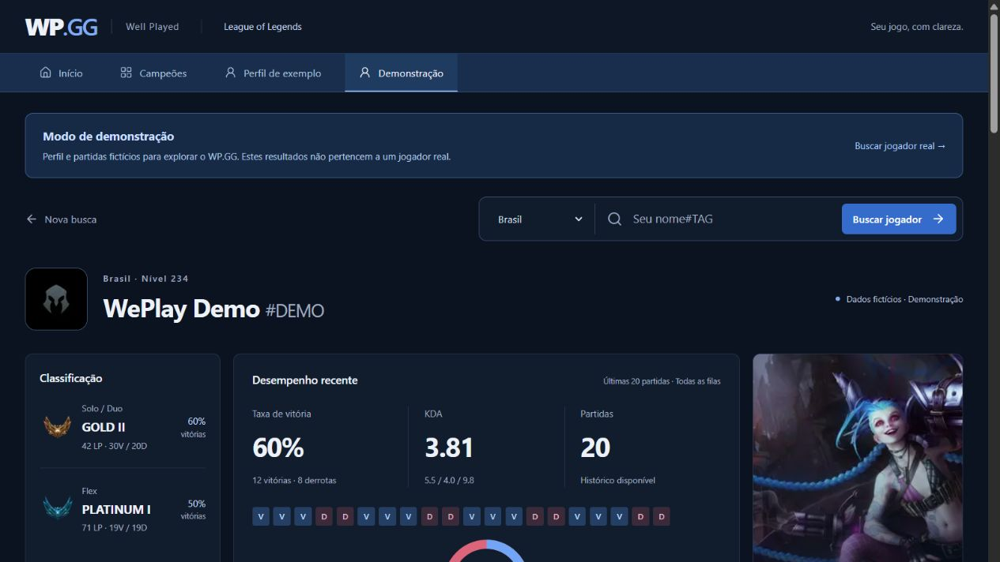

# WP.GG

**Well Played. Seu desempenho, com clareza.**

Versão **1.0.0** — MVP local concluído. Confira as funcionalidades e verificações no [histórico da versão](CHANGELOG.md). A hospedagem ainda não foi realizada.

MVP de portfólio para explorar perfis de League of Legends, classificação, últimas partidas e campeões. Construído com **Next.js, TypeScript, Tailwind CSS e SQLite**, com integração server-side à Riot API e imagens oficiais do Data Dragon.



### Experimente sem chave Riot

Depois de iniciar o projeto, abra [a demonstração local](http://localhost:3000/demo). O perfil fictício tem 20 partidas, gráfico de vitórias, filtros por modo e detalhes dos dez jogadores. As imagens precisam de internet. A porta padrão é 3000; se iniciar com `pnpm dev --port 3001`, use `http://localhost:3001/demo`.

### Principais recursos

- Busca de jogadores por Riot ID completo e servidor.
- Classificação Solo/Duo e Flex, KDA e gráfico de vitórias.
- Histórico de 20 partidas com filtro por modo e equipes expansíveis.
- Campeões mais jogados, aliados com mais vitórias e adversários com mais derrotas.
- Catálogo de campeões com análises da amostra local.
- Modo de demonstração identificado, sem chave e sem gravar partidas fictícias no banco.

Projeto independente de estudo, inspirado em funcionalidades de sites como OP.GG, com identidade visual própria. O envio do código ao GitHub não publica o site na internet. Veja abaixo a configuração, os testes e as limitações da amostra.

## Campeões

A análise de `/campeoes/[id]` inclui páginas de runas, fragmentos, pares de feitiços, conjuntos de itens finais, itens mais presentes, adversários na mesma posição e duplas de atirador/suporte. Cada seção mostra cobertura, quantidade de jogos e taxas observadas; não é uma recomendação global. A galeria de skins usa o catálogo oficial, sem ranking de popularidade.

Os dados adicionais são incorporados aos registros existentes quando um perfil é reconsultado, mantendo uma partida por match ID. A composição dos itens finais é ordenada por ID apenas para agrupar conjuntos iguais, não indica cronologia de compra; itens repetidos contam uma vez por jogo nas frequências individuais. Runas são agrupadas por página completa incluindo fragmentos. Feitiços são agrupados sem distinguir os atalhos D/F. Confrontos exigem times opostos e a mesma posição; sinergias usam BOTTOM e UTILITY do mesmo time. Sem metadados de posição/time, essas seções não inventam relacionamentos.

Itens iniciais, ordem de compra e progressão das habilidades ainda requerem coleta do Match-V5 timeline. Ranking global de maestria não está implementado. Os dados não são copiados do OP.GG.

`/campeoes` mostra o catálogo Data Dragon em português, busca por nome, classes e estatísticas locais. Os filtros incluem posição observada, servidor da partida, fila (Solo/Duo e Flex) e patch da partida. É possível ordenar por nome, jogos, vitória, escolha e banimento. `/campeoes/[id]` mostra atributos base e habilidades oficiais, sem recomendações de builds inventadas. O catálogo funciona sem uma chave Riot.

Ao consultar perfis com sucesso, suas partidas ranqueadas de dez participantes são adicionadas à tabela SQLite `champion_samples`. Cada match ID é armazenado apenas uma vez. A amostra não guarda nomes, tags ou PUUIDs dos participantes. O catálogo e as estatísticas podem ser atualizados recarregando a página de campeões depois de consultar novos perfis.

Vitória = vitórias / jogos do campeão; escolha = jogos do campeão / partidas selecionadas (restringindo a posição quando filtrada); banimento = partidas com o campeão banido / partidas selecionadas. Bans repetidos na mesma partida contam uma única vez. Filas não ranqueadas são excluídas. Não há estatística por elo, pois o Match-V5 não fornece a classificação de cada participante naquele momento.

O painel lê até 10.000 partidas locais. Uma amostra de perfis consultados não é representativa do servidor inteiro: não é uma tier list global, não exibe notas S/A/B ou counters e não utiliza números do OP.GG. O tamanho da amostra e a metodologia aparecem na interface. O patch do catálogo é separado do filtro de patches das partidas.

## Persistência de elo (sem painel no perfil)

O WP.GG salva uma observação diária por jogador, servidor e fila (Solo/Duo e Flex) a cada consulta de perfil concluída. Uma nova consulta no mesmo dia atualiza a observação desse dia, sem duplicá-la. Datas seguem Brasília. Não há consulta automática em segundo plano: dias sem visitas ficam sem registro. As classificações observadas podem refletir o cache da Riot por até dois minutos.

O SQLite é criado automaticamente em `.data/wp-gg.sqlite`, sem configuração adicional no computador. O histórico permanece após reiniciar o servidor. Preserve esse arquivo em backups. `WP_DATABASE_PATH` permite configurar outro caminho no servidor; o banco não contém a chave Riot e fica ignorado pelo Git. Testes usam bancos temporários isolados.

O painel de histórico de elo foi removido do perfil. O módulo de persistência permanece no servidor, preservando os registros existentes. Perfis sem classificação também são registrados explicitamente. A Riot API não entrega o histórico de temporadas anteriores: o acompanhamento começa na primeira consulta após esta funcionalidade. Não estimamos elo antigo a partir de partidas nem importamos dados do OP.GG.

Para publicar com esta implementação, use Node.js 22.13+ (preferencialmente 24) e um volume persistente com permissão de escrita. Hospedagens com filesystem efêmero precisam de armazenamento externo e adaptação do repositório de dados antes de publicar; não basta copiar o SQLite para uma função temporária. Em múltiplas instâncias, use um banco compartilhado. Falhas de armazenamento mostram aviso no histórico e não impedem a consulta do perfil.

MVP de portfólio inspirado nas informações de sites como OP.GG, com identidade própria: tema escuro, acentos azuis, componentes reutilizáveis e interface responsiva em português.

## Executar

Requisitos: Node.js 22.13 ou superior (recomendado: Node.js 24) e pnpm (ou npm).

```sh
pnpm install
```

Copie `.env.example` para `.env.local` na raiz do projeto e configure sua chave do [Riot Developer Portal](https://developer.riotgames.com/):

```dotenv
RIOT_API_KEY=sua_chave_aqui
```

```sh
pnpm dev
```

Abra http://localhost:3000. Busque **GoBacck#br1**, com servidor **Brasil**, ou clique no atalho da página inicial. O perfil está em http://localhost:3000/perfil/br1/GoBacck%23br1.

Com npm: `npm install`, `npm run dev`, `npm run build` e `npm start`. O lockfile fornecido pertence ao pnpm; use pnpm para instalações reproduzíveis.

Sem chave, a página inicial funciona e o perfil mostra instruções de configuração. O modo de demonstração em `/demo` usa um perfil fictício identificado na tela e funciona sem chave. Reinicie o servidor depois de alterar `.env.local`. Chaves de desenvolvimento expiram; renove-as no portal quando necessário. Não envie sua chave para o navegador e não use prefixo `NEXT_PUBLIC_`.

## Verificações e produção

```sh
pnpm typecheck
pnpm test
pnpm build
pnpm start
```

Na hospedagem, configure `RIOT_API_KEY` como segredo do servidor. Precisa de runtime Node.js com suporte a Next.js; não use exportação estática. Antes de servir publicamente, registre o produto no portal da Riot e use uma chave adequada ao uso. Não há publicação automática neste projeto.

## O que está implementado

- Busca por Riot ID e servidor; atalho para GoBacck#br1.
- Perfil com ícone, nível, classificação Solo/Duo e Flex e pontos de liga.
- Estatísticas das últimas 20 partidas disponíveis: vitórias/derrotas, gráfico circular, KDA agregado e campeões mais jogados sempre visíveis.
- Filtro do histórico por modo de jogo, aplicado somente às partidas carregadas; estatísticas gerais permanecem em todas as filas.
- Até cinco aliados com mais vitórias e cinco adversários com mais derrotas, com mínimo de duas partidas por campeão. Seu próprio personagem e jogos abaixo de cinco minutos são excluídos.
- Histórico com campeão, posição, resultado, data, duração, K/D/A, CS, CS/min e itens. Ao expandir, mostra todos os participantes por time, com links de perfil, nível do campeão, participação em abates, dano a campeões, visão e itens; totais de abates e ouro do time.
- Estados de carregamento, histórico vazio, jogador não encontrado, chave ausente/expirada, limite de chamadas e indisponibilidade.
- Chamadas exclusivamente em Server Components com módulo `server-only`; chave enviada pelo cabeçalho `X-Riot-Token`.

## Estrutura

```text
src/app/                         Layout, início e estados globais
src/app/perfil/[platform]/[riotId]/ Perfil dinâmico e carregamento
src/components/                  Busca, cartões, cabeçalho e rodapé
src/lib/riot.ts                  Cliente server-side Riot / Data Dragon
src/lib/stats.ts                 Validação, roteamento e estatísticas
src/lib/types.ts                 Contratos de dados
tests/                          Testes de cálculos e validação
```

## Integração

1. Account-V1 resolve nome + tag para PUUID pela rota regional.
2. Summoner-V4 e League-V4 consultam o perfil e o elo pela plataforma, usando PUUID.
3. Match-V5 obtém os últimos 20 IDs pela região e detalhes em lotes de três.
4. Data Dragon fornece versão atual, catálogo de campeões e imagens de perfil, campeões e itens.

Brasil usa `br1` para perfil/elo e `americas` para conta/partidas. A tag do Riot ID **não determina o servidor**; selecione o servidor correto. Também estão disponíveis NA, LAN, LAS, EUW, EUNE, KR e JP.

Perfil e IDs usam cache de 120 segundos; partidas completas, uma hora; Data Dragon, 24 horas. Cada chamada tem timeout de 12 segundos. Erros 429 exibem o tempo informado por `Retry-After` sem tentativas automáticas. Partidas individuais com 404 são omitidas com aviso explícito. Outros erros interrompem a consulta para evitar mostrar métricas incompletas sem aviso.

KDA é `(soma de kills + soma de assists) / soma de deaths`; zero mortes aparece como “Perfeito”. A taxa recente usa todas as filas do histórico, enquanto os resultados do elo pertencem à temporada/fila retornada pela Riot. Horários usam America/Sao_Paulo. Contas com menos de 20 partidas mostram apenas as disponíveis.

## Limites deste MVP

Sem autenticação. O histórico de elo é persistido localmente em SQLite. A fila desconhecida aparece por seu ID. Os itens do histórico exibem ícones e IDs; a análise dos campeões já inclui runas e feitiços. Resumos de temporada ainda não estão implementados. Recursos usam a versão atual do Data Dragon, que pode diferir do patch de partidas antigas. O limite é tratado por consulta; antes de escalar para vários usuários, adicione controle de taxa global e cache persistente compartilhado. Sem chave válida não é possível validar os dados reais de GoBacck#br1.

Referências: [Riot API](https://developer.riotgames.com/apis), [Roteamento e Data Dragon](https://developer.riotgames.com/docs/lol), [Next.js](https://nextjs.org/docs/app/getting-started/installation).


## Modo de demonstração

Abra `/demo` ou clique em **Demonstração** no menu. O perfil **WePlay Demo#DEMO** contém 20 partidas fictícias fixas, distribuídas entre Solo/Duo, Flex e ARAM. Filtros, gráfico, campeões mais jogados, aliados/adversários e detalhes das equipes usam os mesmos componentes do perfil real.

Não é necessário configurar `RIOT_API_KEY` para essa rota: os dados vêm de `src/lib/demo-profile.ts`, sem chamadas à Riot API ou escrita no SQLite. Não há substituição automática de um jogador real por dados fictícios. Quando uma consulta real falha, a tela oferece um link para a demonstração.

Imagens continuam sendo carregadas do Data Dragon pela internet; o catálogo visual da demonstração usa a versão fixa 16.1.1. Os participantes fictícios não têm links para contas reais. As páginas de campeões continuam usando o catálogo e a amostra local reais, sem receber partidas simuladas.
